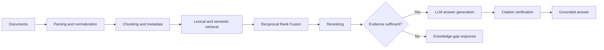

<p align="center">
  
</p>

<h1 align="center">TrustAware RAG Knowledge Assistant</h1>
<p align="center"><b>Document-grounded question answering with hybrid retrieval, citations and confidence-aware knowledge-gap handling.</b></p>

<p align="center">
  
  
  
  
</p>

## Project overview

TrustAware RAG Knowledge Assistant is a Retrieval-Augmented Generation application. Users upload knowledge sources, ask natural-language questions, and receive responses grounded in retrieved document evidence. The system combines lexical and semantic retrieval, Reciprocal Rank Fusion (RRF), reranking, evidence checks, source citations and knowledge-gap handling.

**Repository:** https://github.com/Ganeshbasani/RAG-Knowledge-Assistant  
**Live demo:** Add the verified deployment URL here. A live URL was not available in the repository review context, so none is fabricated.

## Key capabilities

- **Multi-format ingestion:** PDF, DOCX, PPTX, XLSX, CSV/TSV, JSON, HTML, RTF, TXT, Markdown and common image formats with OCR.
- **Hybrid retrieval:** keyword/BM25 and semantic retrieval modes.
- **Ranking:** Reciprocal Rank Fusion and configurable lightweight reranking.
- **Grounded generation:** LLM answers generated from retrieved evidence, with source citations.
- **Knowledge-gap handling:** insufficient evidence can trigger a no-answer response rather than unsupported claims.
- **Trust diagnostics:** citation verification and potentially outdated/conflicting-source warnings.
- **Chat experience:** responsive interface, conversation history, chat search, rename/delete, Markdown export and streaming.
- **Evaluation:** curated answerable, unanswerable, adversarial and conflict cases; Recall@K, NDCG, abstention accuracy and citation precision.

## Screenshots

The original repository already contains four application captures. Keep these files in the `Screenshots/` directory and rename them to the descriptive names below if you choose to normalize the folder. The README references the current original filenames until those renames are made.

| Capture | Existing image |
|---|---|
| Application view 01 | `Screenshots/Screenshot 2026-11-23 010347.png` |
| Application view 02 | `Screenshots/Screenshot 2026-11-23 010354.png` |
| Application view 03 | `Screenshots/Screenshot 2026-11-23 010842.png` |
| Application view 04 | `Screenshots/Screenshot 2026-11-23 010917.png` |

## Architecture



## Technology stack

| Layer | Technologies |
|---|---|
| Backend | Python, FastAPI, Pydantic, Uvicorn |
| Retrieval | BM25/lexical search, semantic embeddings, hybrid retrieval, RRF |
| Reranking | Term-overlap; optional cross-encoder |
| LLM adapters | OpenRouter, Gemini, OpenAI-compatible endpoints, Anthropic and Ollama (configuration-dependent) |
| Vector storage | Embedded JSON index by default; optional Qdrant |
| Metadata | SQLite by default; optional PostgreSQL |
| Frontend | Responsive HTML, CSS and JavaScript |
| Delivery | Docker, Docker Compose, Render configuration |
| Quality | Automated tests and retrieval evaluation harness |

## Quick start

```bash
git clone https://github.com/Ganeshbasani/RAG-Knowledge-Assistant.git
cd RAG-Knowledge-Assistant/rag-knowledge-assistant-main
python -m venv .venv
```

Windows PowerShell:
```powershell
.\\.venv\\Scripts\\Activate.ps1
pip install -e ".[dev]"
Copy-Item .env.example .env
```

macOS / Linux:
```bash
source .venv/bin/activate
pip install -e ".[dev]"
cp .env.example .env
```

Start the application:
```bash
rag-knowledge-assistant
```

Or:
```bash
uvicorn rag_assistant.api:app --reload --app-dir src
```

Open `http://127.0.0.1:8000/ui/`.

## API overview

| Method | Endpoint | Purpose |
|---|---|---|
| GET | `/health` | Liveness |
| GET | `/ready` | Readiness and storage probe |
| GET | `/stats` | Index statistics |
| GET | `/documents` | List documents |
| POST | `/ingest` | Ingest raw text |
| POST | `/ingest/file` | Upload and ingest a file |
| POST | `/ingest/bulk` | Bulk ingestion |
| POST | `/query` | Grounded Q&A; optional SSE streaming |
| POST | `/query/semantic` | Semantic-only retrieval |
| POST | `/evals/run` | Run retrieval evaluation |
| GET | `/metrics` | Runtime metrics |

## Security and deployment notes

- API-key authentication is optional for local use and required by the documented production configuration.
- Provider API keys must remain server-side and must never be committed.
- Request IDs, safe errors, rate limiting and upload-size controls are documented.
- The free Render configuration may sleep and uses ephemeral storage. Treat it as a portfolio demo, not a persistent production workspace.
- The default JSON vector index is intended for a small single-instance deployment. Multi-instance production requires shared durable storage.

## Suggested recruiter walkthrough

1. Upload a small, non-sensitive document.
2. Ask a question whose answer is explicitly present in that document.
3. Inspect the generated answer and its citations.
4. Ask an unrelated question to demonstrate knowledge-gap behavior.
5. Review `/health` and the evaluation fixtures.

## Resume-ready summary

> Built a trust-aware Retrieval-Augmented Generation application using Python and FastAPI, featuring multi-format document ingestion, hybrid lexical and semantic retrieval, Reciprocal Rank Fusion, reranking, evidence-grounded LLM responses, source citations, confidence-aware knowledge-gap handling, API security controls, Docker deployment configuration and retrieval evaluation.

## Scope transparency

Optional providers and storage backends require configuration and should not be assumed active in every deployment. This README describes capabilities documented in the repository. The default JSON vector index is a small single-instance design; shared persistence and horizontal scaling require an appropriate shared backend.

## License

MIT — see [LICENSE](LICENSE).
