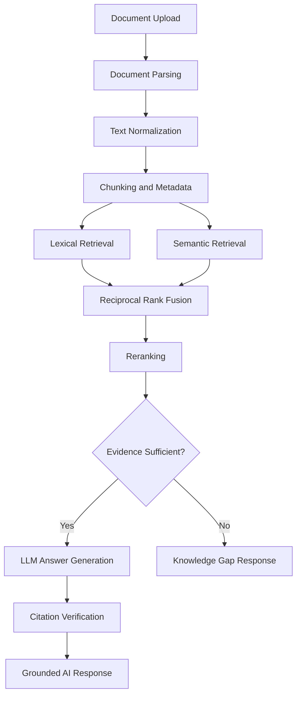

<p align="center">
  
</p>

<h1 align="center">TrustAware RAG Knowledge Assistant</h1>

<p align="center">
  <b>Intelligent Document-Grounded AI | Hybrid Retrieval | Verified Citations | Trust-Aware Responses</b>
</p>

<p align="center">
  <a href="https://rag-knowledge-assistant-2-eabe.onrender.com/ui/">
    
  </a>
  <a href="https://github.com/Ganeshbasani/RAG-Knowledge-Assistant">
    
  </a>
</p>

<p align="center">
  
  
  
  
  
</p>

---

## 🚀 Live Application

<p align="center">
  <a href="https://rag-knowledge-assistant-2-eabe.onrender.com/ui/">
    
  </a>
</p>

**Live URL:** https://rag-knowledge-assistant-2-eabe.onrender.com/ui/

**Repository:** https://github.com/Ganeshbasani/RAG-Knowledge-Assistant

---

## 📌 Project Overview

TrustAware RAG Knowledge Assistant is an intelligent Retrieval-Augmented Generation (RAG) application that enables users to upload documents, ask natural-language questions, and receive answers grounded in retrieved document evidence.

Unlike ordinary AI chatbots, this application combines lexical and semantic retrieval, Reciprocal Rank Fusion (RRF), reranking, evidence validation, source citations, and knowledge-gap handling to improve answer reliability.

The system is designed to reduce hallucinations by prioritizing document-grounded responses and handling questions when sufficient evidence is unavailable.

## ✨ Key Features

### 📂 Multi-Format Document Ingestion
- PDF
- DOCX
- PPTX
- XLSX
- CSV / TSV
- JSON
- HTML
- RTF
- TXT
- Markdown
- Common image formats with OCR support

### 🧠 Advanced Hybrid Retrieval
- Keyword-based retrieval
- BM25 / lexical search
- Semantic vector retrieval
- Hybrid retrieval strategies
- Reciprocal Rank Fusion (RRF)
- Configurable reranking

### 🎯 Trust-Aware AI Responses
- Document-grounded answer generation
- Source-level citations
- Citation verification
- Evidence sufficiency checks
- Knowledge-gap detection
- No-answer responses when evidence is insufficient
- Potentially outdated and conflicting-source warnings

### 💬 Intelligent Chat Interface
- Responsive user interface
- Conversation history
- Chat search
- Rename and delete conversations
- Markdown export
- Streaming responses

### 📊 Evaluation and Quality
- Answerable question evaluation
- Unanswerable question evaluation
- Adversarial test cases
- Conflicting-source evaluation
- Recall@K
- NDCG
- Abstention accuracy
- Citation precision

---

## 🖥️ Application Screenshots

<p align="center">
  <b>01 — Main Application Interface</b>
</p>

<p align="center">
  
</p>

<p align="center">
  <b>02 — Document Processing and Knowledge Ingestion</b>
</p>

<p align="center">
  
</p>

<p align="center">
  <b>03 — AI-Powered Question Answering</b>
</p>

<p align="center">
  
</p>

<p align="center">
  <b>04 — Grounded Responses and Citations</b>
</p>

<p align="center">
  
</p>

---

## 🏗️ System Architecture



## 🛠️ Technology Stack

| Layer | Technologies |
|---|---|
| Programming | Python |
| Backend | FastAPI, Pydantic, Uvicorn |
| Frontend | HTML, CSS, JavaScript |
| Retrieval | BM25, Semantic Search, Hybrid Retrieval |
| Ranking | Reciprocal Rank Fusion, Reranking |
| AI / LLM | OpenRouter, Gemini, OpenAI-compatible endpoints, Anthropic, Ollama (configuration-dependent) |
| Vector Storage | JSON index, optional Qdrant |
| Database | SQLite, optional PostgreSQL |
| Deployment | Docker, Docker Compose, Render |
| Evaluation | Retrieval evaluation and automated tests |

## 🔄 How It Works

1. **Upload:** Users upload knowledge sources in supported formats.
2. **Parsing:** Documents are parsed and normalized.
3. **Chunking:** Extracted content is divided into manageable chunks with metadata.
4. **Retrieval:** The system searches using lexical and semantic retrieval.
5. **Fusion:** Reciprocal Rank Fusion combines relevant results.
6. **Reranking:** Retrieved passages are reordered by relevance.
7. **Evidence Validation:** The system evaluates whether sufficient evidence exists.
8. **Generation:** The LLM generates a document-grounded response.
9. **Citation Verification:** Sources are checked to support the generated answer.
10. **Response:** The application returns an answer or an appropriate knowledge-gap response.

### OpenRouter resilience and evidence reporting

The OpenRouter adapter uses independent connect/read timeouts and a bounded retry count (`RAG_LLM_CONNECT_TIMEOUT_SECONDS`, `RAG_LLM_READ_TIMEOUT_SECONDS`, and `RAG_LLM_MAX_RETRIES`). It respects `Retry-After` for transient provider limits and can route through optional comma-separated `RAG_LLM_FALLBACK_MODELS`. Provider errors are classified and reported without logging provider response bodies or credentials. A passage-based fallback is labeled when generation fails.

The API leaves `confidence` null and the UI does not show an evidence percentage until a representative labeled evaluation set can calibrate one. Retrieval ranking scores are not probabilities. An empty retrieval returns an insufficient-evidence response and never calls the model without document passages.

---

## ⚙️ Installation and Local Setup

### 1. Clone Repository

```bash
git clone https://github.com/Ganeshbasani/RAG-Knowledge-Assistant.git

cd RAG-Knowledge-Assistant/rag-knowledge-assistant-main
```

### 2. Create Virtual Environment

```bash
python -m venv .venv
```

### 3. Activate Environment

**Windows PowerShell:**

```powershell
.\.venv\Scripts\Activate.ps1
```

**macOS / Linux:**

```bash
source .venv/bin/activate
```

### 4. Install Dependencies

```bash
pip install -e ".[dev]"
```

### 5. Configure Environment

**Windows:**

```powershell
Copy-Item .env.example .env
```

**macOS / Linux:**

```bash
cp .env.example .env
```

Configure the required provider credentials and application settings in `.env` as applicable.

### 6. Run Application

```bash
rag-knowledge-assistant
```

Alternatively:

```bash
uvicorn rag_assistant.api:app --reload --app-dir src
```

### 7. Open Application

```text
http://127.0.0.1:8000/ui/
```

---

## 🔌 API Endpoints

| Method | Endpoint | Description |
|---|---|---|
| GET | `/health` | Application liveness |
| GET | `/ready` | Readiness and storage probe |
| GET | `/stats` | Index statistics |
| GET | `/documents` | List ingested documents |
| POST | `/ingest` | Ingest raw text |
| POST | `/ingest/file` | Upload and ingest a file |
| POST | `/ingest/bulk` | Bulk document ingestion |
| POST | `/query` | Grounded question answering |
| POST | `/query/semantic` | Semantic-only retrieval |
| POST | `/evals/run` | Run retrieval evaluations |
| GET | `/metrics` | Runtime metrics |

---

## 🔐 Security and Reliability

- Optional API-key authentication for local use.
- Production API-key configuration.
- Server-side provider API key handling.
- Request ID tracking.
- Safe error responses.
- Rate limiting.
- Upload-size controls.
- Readiness and health endpoints.
- Deployment configuration for Docker and Render.

**Deployment consideration:** The free Render configuration may sleep and uses ephemeral storage. The default JSON vector index is intended for small, single-instance deployments. Persistent shared storage and horizontal scaling require suitable infrastructure.

For durable Render storage, the least-change option is a paid single-instance service with a disk mounted at `/app/data`, matching the current JSON index and upload directory. The free web tier cannot attach a persistent disk and loses local files on restart or spin-down. An external Postgres database alone is not enough for this app's current default because chunks and vectors still live in the JSON vector store. For a remote-store setup, configure Qdrant with `RAG_VECTOR_STORE=qdrant`, `RAG_QDRANT_URL`, and `RAG_QDRANT_API_KEY`, and configure `RAG_DB_URL` for durable document metadata; Qdrant payloads retain chunk text and metadata, while the original uploaded file bytes remain on local storage unless a separate object-storage integration is added.

### Render environment variables

- Set `RAG_LLM_PROVIDER=openrouter`, `RAG_LLM_MODEL=openrouter/free`, and either `OPENROUTER_API_KEY` or `RAG_LLM_API_KEY`. The provider key is read only by the server; never put it in frontend code.
- `RAG_API_KEY` is separate from the provider key and protects API routes. Leave it unset for the public demo (rate limits still apply). For a protected browser UI, configure both `RAG_UI_PASSWORD` and `RAG_JWT_SECRET`; the UI exchanges the passphrase for a short-lived JWT held in `sessionStorage`. An API-key-only deployment remains usable by API clients, but the browser UI will show that browser sign-in is not configured.
- `RAG_UI_PASSWORD` is one shared workspace passphrase, not a per-user identity system. Use a long random value over HTTPS, and use a dedicated identity provider for multi-user production access.
- `RAG_LLM_CONNECT_TIMEOUT_SECONDS`, `RAG_LLM_READ_TIMEOUT_SECONDS`, `RAG_LLM_MAX_RETRIES`, and optional `RAG_LLM_FALLBACK_MODELS` tune bounded provider retries. `llm_enabled` is a health-response field, not a Render environment variable.
- Render's free filesystem is temporary. Uploaded documents and the JSON index can disappear after a restart or redeploy; durable persistence needs a persistent disk or an external storage service.

---

## 🧪 Suggested Demo Walkthrough

Recruiters and reviewers can explore the application using the following steps:

1. Open the live application.
2. Upload a sample PDF or other supported document.
3. Ask a question whose answer exists in the uploaded document.
4. Review the generated answer and source citations.
5. Ask an unrelated question to test knowledge-gap handling.
6. Inspect the health endpoint and evaluation capabilities.

**Live Demo:** https://rag-knowledge-assistant-2-eabe.onrender.com/ui/

---

## 💼 Resume-Ready Project Description

Built a TrustAware Retrieval-Augmented Generation application using Python and FastAPI, implementing multi-format document ingestion, hybrid lexical and semantic retrieval, Reciprocal Rank Fusion, reranking, evidence-grounded LLM responses, source citations, honest knowledge-gap handling, API security controls, Docker deployment configuration, and retrieval evaluation.

## 📁 Repository Structure

```text
RAG-Knowledge-Assistant/
│
├── README.md
├── assets/
│   └── rag-hero.gif
│
├── Screenshots/
│   ├── Screenshot 2026-11-23 010347.png
│   ├── Screenshot 2026-11-23 010354.png
│   ├── Screenshot 2026-11-23 010842.png
│   └── Screenshot 2026-11-23 010917.png
│
├── rag-knowledge-assistant-main/
│   ├── src/
│   ├── tests/
│   ├── evals/
│   ├── docs/
│   ├── .env.example
│   ├── pyproject.toml
│   └── Dockerfile
│
└── LICENSE
```

*Illustrative structure: actual repository contents may include additional files and directories.*

---

## 🔭 Future Improvements

Potential areas for further development:

- Advanced retrieval optimization.
- Calibrated evidence confidence against a labeled dataset.
- Expanded evaluation and CI quality gates.
- Enhanced observability.
- Improved resilience and fault handling.
- Additional storage and LLM provider integrations.

---

## 📜 License

This project is licensed under the MIT License. See the [LICENSE](LICENSE) file for details.

---

## 👨‍💻 Developer

**Ganesh Basani**

- GitHub: https://github.com/Ganeshbasani
- Portfolio: https://protfolio4.netlify.app/

<p align="center">
  <b>Built with Python, FastAPI, Retrieval-Augmented Generation and a focus on trustworthy AI.</b>
</p>

<p align="center">
  ⭐ If you find this project interesting, consider starring the repository!
</p>
